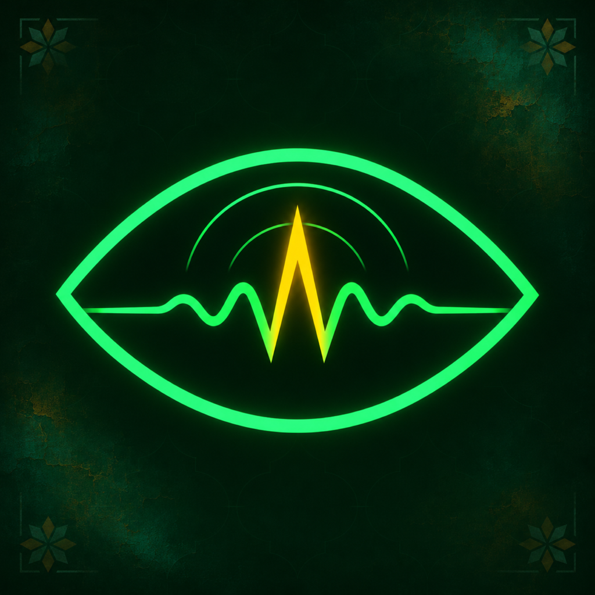
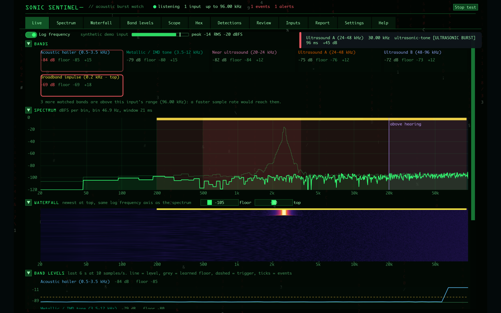
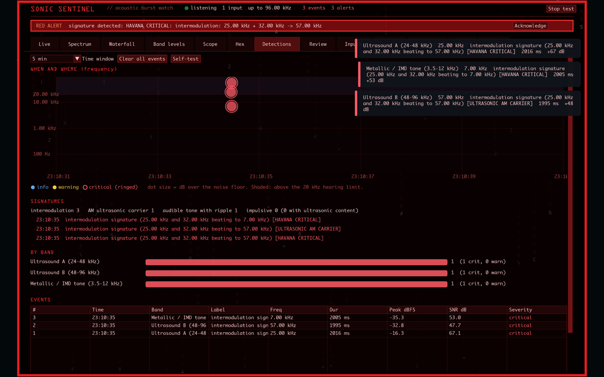
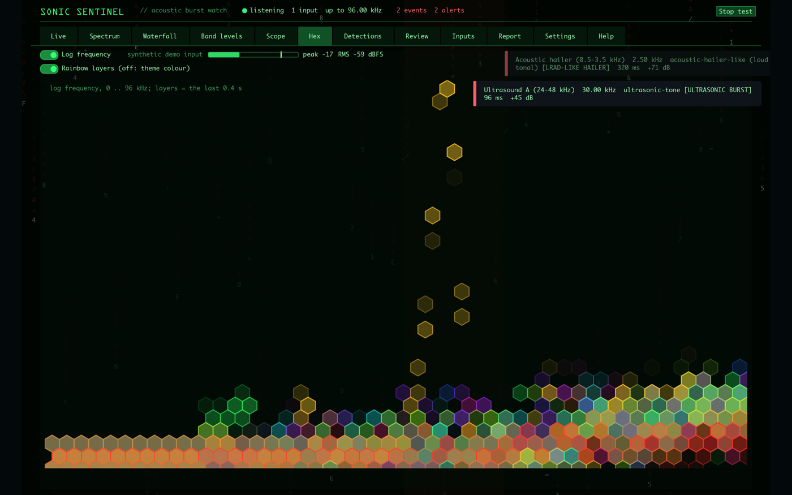
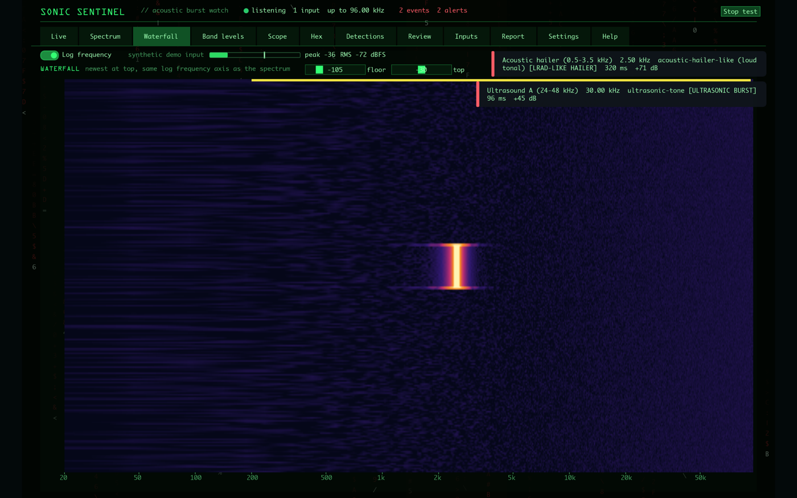
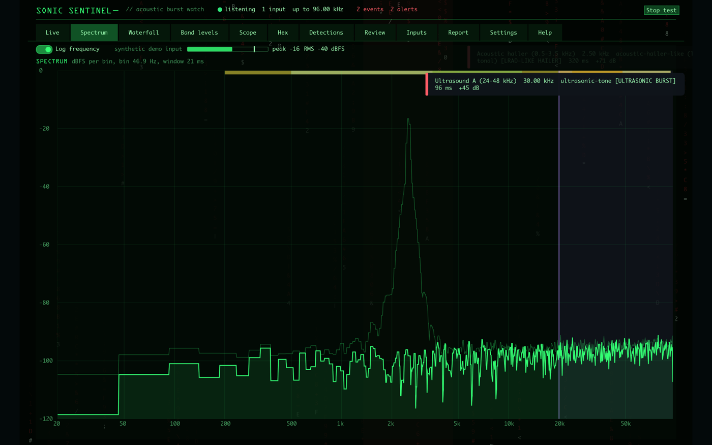
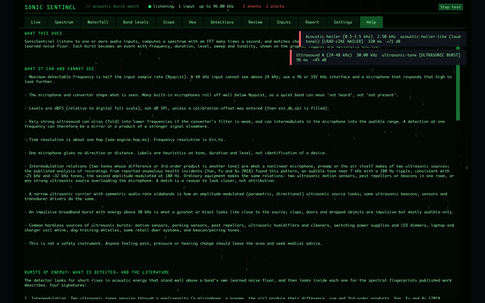
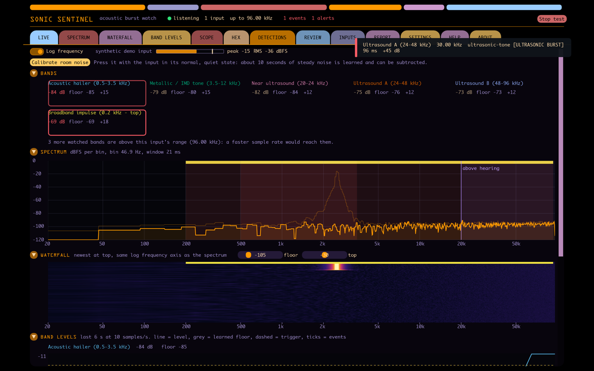

# Sonic Sentinel

**Acoustic burst watch for macOS and iOS.** See the sound you can't hear.

{: width="128"}

Sonic Sentinel is a listening post for ultrasound and other sound outside normal hearing. It watches the audio input you choose, analyses it many times a second, and shows the spectrum, a waterfall and a log of detections. When something rises well above the room's own learned noise floor, it becomes a detection you can see, log and be alerted about.

It runs entirely on your device. Audio is analysed in memory and is never recorded or sent anywhere, and the app makes no network connections.

## What it does

- **Live spectrum, waterfall and band levels** on a log or linear frequency axis. Double-click any view to fill the window.
- **Detections:** a time and frequency map, per-band counts and a full event table, plus a Review tab that replays saved bursts.
- **Ultrasonic tones, bursts and sweeps,** with the sweep shape named: linear, hyperbolic, exponential, stepped or repeating.
- **Published acoustic signatures:** two ultrasonic tones beating down to an audible one, amplitude-modulated ultrasonic carriers, and audible tones with a ripple. A strong signature turns the whole interface red until you acknowledge it.
- **Everyday sources it tells apart** so they don't look like threats: phone tones, motion sensors, pest repellers and bat calls. Each detection model can be switched on or off.
- **Room-noise calibration:** learn the steady background noise once and subtract it from the analysis.
- **Many inputs:** built-in microphone, USB and Thunderbolt interfaces, loopback devices for system audio, and WAV recordings.
- **Made for analysis:** reports in JSON, Markdown and CSV written to be read by people and by language models, and a headless command-line mode.

## Private by design

No accounts, no analytics, no advertising and no tracking. Settings, detection logs and exported reports are encrypted on the device with AES-256-GCM, with a key derived from your account name and a salt you control. Notifications and alert sounds are off until you turn them on. Read the full [privacy policy](/privacy/).

## Honest about its limits

Sonic Sentinel detects sound. It cannot identify a device or a person, it cannot detect radio or microwave energy, and its labels are heuristics that mean "look closer". It is not a medical or safety device. Seeing ultrasound needs an audio interface running at 96 or 192 kHz and a microphone that reaches those frequencies; at 48 kHz it shows the audible side only, and the app tells you what each input can reach.

## Screenshots

Full-size images (2560 x 1600) are in the press kit below. They were taken with the app's built-in demo signal, so they show synthetic data.

## Press kit

| File | Use |
|---|---|
| [App icon, 1024 px](/press-kit/sonic-sentinel-icon-1024.png) | Logo and icon |
| [Live view](/press-kit/01-live.png) | Main screen |
| [Red alert](/press-kit/02-red-alert.png) | A signature detected |
| [Hex view](/press-kit/03-hex.png) | Spectrum as a hexagon field |
| [Waterfall](/press-kit/04-waterfall.png) | Full-window waterfall |
| [Spectrum](/press-kit/05-spectrum.png) | Full-window spectrum |
| [Band levels](/press-kit/06-band-levels.png) | Per-band levels over time |
| [Space UI theme](/press-kit/07-space-ui-theme.png) | The alternative theme |

## Facts

| | |
|---|---|
| **Name** | Sonic Sentinel |
| **Platforms** | macOS and iOS |
| **Developer** | Daniel Rosser |
| **Category** | Utilities |
| **Privacy** | No data collected: [privacy policy](/privacy/) |
| **Support** | [Support page](/support/) and [danoli3.com](https://danoli3.com) |

## Contact

For press enquiries, interviews or review copies, get in touch through [danoli3.com](https://danoli3.com).
